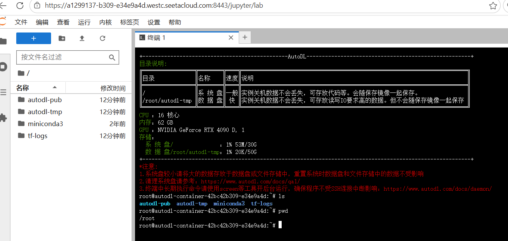

环境：
以下是 AutoDL 的官方网址和完整的购买操作流程，  
第一步：访问官网并注册
AutoDL 官网：https://www.autodl.com/

算力市场（选卡租用）：https://www.autodl.com/market/list

帮助文档（遇到问题查这里）：https://www.autodl.com/docs/  

第二步：充值
注册登录后，先在个人中心充值。AutoDL 是预付费模式，账户里有余额才能下单租用实例。

🖥️ 第三步：租用实例（核心步骤）
进入算力市场，点击 “租用新实例”，按以下顺序选择：

选择计费方式：调试阶段务必选“按量计费”，用多久算多久，灵活省钱。

选择 GPU 型号：你的 vLLM 学习，首选 RTX 4090D（24GB 显存），约 ¥1.88/小时，性价比最高，且比 4090 更容易租到。如果预算有限，也可以选 RTX 3090（24GB），约 ¥1.20/小时。

选择地区：不同地区的库存情况不同，重庆A区通常 4090D 的库存比较充足，可以优先看看。

选择镜像：这是最关键的一步。为了跑 vLLM 省去配环境的麻烦，建议直接选 PyTorch 基础镜像（已预装 CUDA），或者找找 vLLM 社区镜像。如果选纯净的 Miniconda 镜像，就需要自己手动安装 vLLM 和依赖。

选择硬盘：系统盘默认约 30GB，如果模型较大，可以按需扩容数据盘（/root/autodl-tmp），用来存放代码和模型权重，释放实例时数据盘的数据会保留。

创建实例：确认配置后点击“立即创建”，等待约 30 秒实例就会开机。

第四步：连接与使用
实例开机后，在控制台可以看到连接信息：

SSH 连接：用终端通过 ssh -p <端口> root@<区域>.seetacloud.com 连接。

JupyterLab：点击快捷工具“JupyterLab”直接在浏览器里操作和上传文件。

VSCode 远程：安装 Remote-SSH 插件，连接实例进行开发。

PyTorch 介绍下  
PyTorch 就是 AI 领域的“C++ 标准库” + “多线程/异构计算调度器”。它是一个披着 Python 外衣，骨子里全是 C++ 和 CUDA 的超级计算框架。  

在你们的推理部署实战中，PyTorch 扮演的是“底座的底座”：

vLLM 是基于 PyTorch 写的：你敲 pip install vllm 的时候，底层其实会强制安装一个对应版本的 PyTorch。

模型是用 PyTorch 存的：你下载的 Qwen 模型文件（.safetensors），里面存的就是 PyTorch 的 Tensor 数据。

GPU 调度靠它：vLLM 底层要把数据从 CPU 搬到显存，最终还是得调用 PyTorch 提供的 C++ 接口（torch.cuda）。

  

开机后的“黄金三连”
等个半分钟，实例变成“运行中”，点击 “JupyterLab” 或者 “终端” 进去，马上执行这三步：

开加速（必做）：

bash
source /etc/network_turbo
(不开这个，你下模型会慢到怀疑人生)

验证显卡：

bash
nvidia-smi
(看到 4090D 和 24GB 显存，说明机器完美)

装 vLLM 跑起来：

bash
pip install vllm