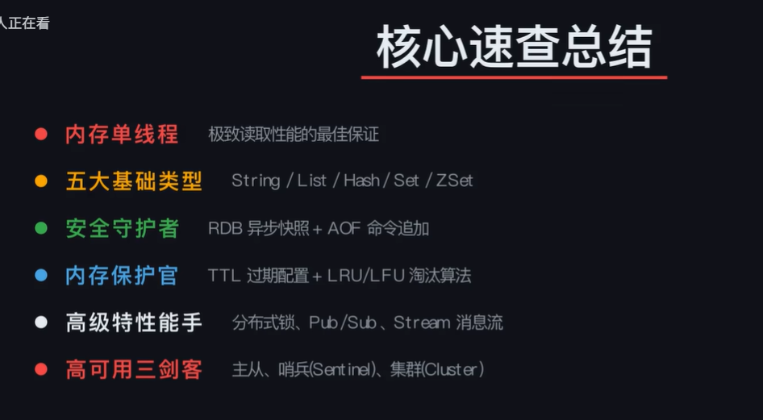
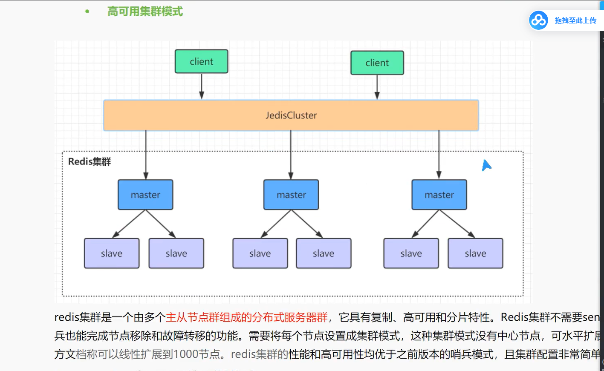

# redis  

---
redis 集群：  
  

---
- 在看redis视频，都是在敲redis命令，我在联想我们公司分布式架构，也用到了redis，但是从来没敲过redis命令。不太理解redis和业务是怎么结合用的  
在你们公司的分布式架构里，Redis命令是怎么被“调用”的？
假设你们公司的5GC核心网里，PCRF或某个网元用了Redis来做用户会话缓存。那么代码里大概率是这样的（以C++伪代码为例）：

cpp
// 这是你们公司某个C++网元里的代码
// 它根本不会去手敲 redis-cli 的命令

// 1. 用户上线时，把会话信息写入Redis
void onUserOnline(const std::string& imsi, const SessionData& data) {
    // 底层调用 Redis 客户端库（比如 hiredis）的 SET 命令
    redisClient.set("session:" + imsi, serialize(data));
    redisClient.expire("session:" + imsi, 3600); // 设置1小时过期
}

// 2. 另一个网元需要查询用户会话时，从Redis读取
SessionData getUserSession(const std::string& imsi) {
    // 底层调用 Redis 客户端库的 GET 命令
    auto value = redisClient.get("session:" + imsi);
    if (value.empty()) {
        // 缓存未命中，去数据库查，然后回写Redis
        return loadFromDatabase(imsi);
    }
    return deserialize(value);
}
你看，代码里写的是 redisClient.set(...) 和 redisClient.get(...)。 这些方法底层会通过网络把对应的 SET 和 GET 命令发给Redis服务器。程序员根本不需要知道Redis命令长什么样，他们只需要调用封装好的API。

🎯 在5GC核心网里，Redis通常扮演什么角色？
结合你的维护经验，Redis在电信级系统里通常出现在这几个位置：

会话缓存（Session Cache）：用户附着到网络后，相关的鉴权、位置、策略信息临时存在Redis里，供多个网元快速共享。这比每次去查核心数据库快得多。

分布式锁：多个网元实例要同时修改同一份配置或用户数据时，用Redis的 SETNX 实现分布式锁，防止并发冲突。

限流与配额：对某个用户或某个接口的请求频率做限制，用Redis的 INCR 和 EXPIRE 实现。

消息队列：网元之间异步传递事件（比如计费话单），用Redis的 LIST 或 Stream 做轻量级消息队列。

📚 你该怎么学？
不要把Redis当成一个“要背命令的工具”，而要把它当成一个“有特定能力的组件”。

看视频时，你只需要搞清楚：

每种数据结构（String/Hash/List/Set/ZSet）适合解决什么问题？

缓存穿透、击穿、雪崩是什么？怎么用代码解决？

分布式锁怎么实现？有什么坑？

至于命令本身，你不需要背。 真正工作中，你只需要知道“我要往缓存里存一个用户会话”，然后去查对应的C++客户端库（如 hiredis、redis-plus-plus）怎么调用 set 就行了。