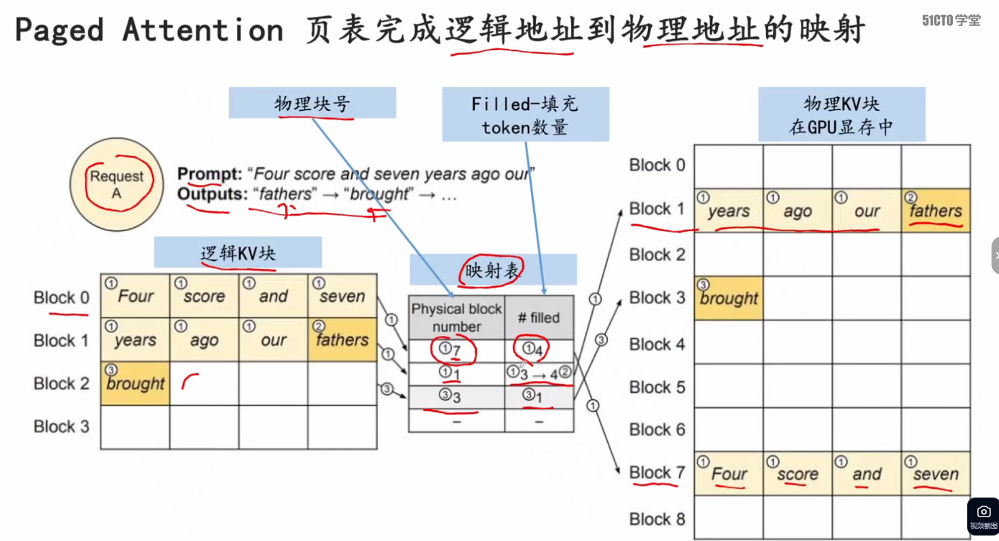
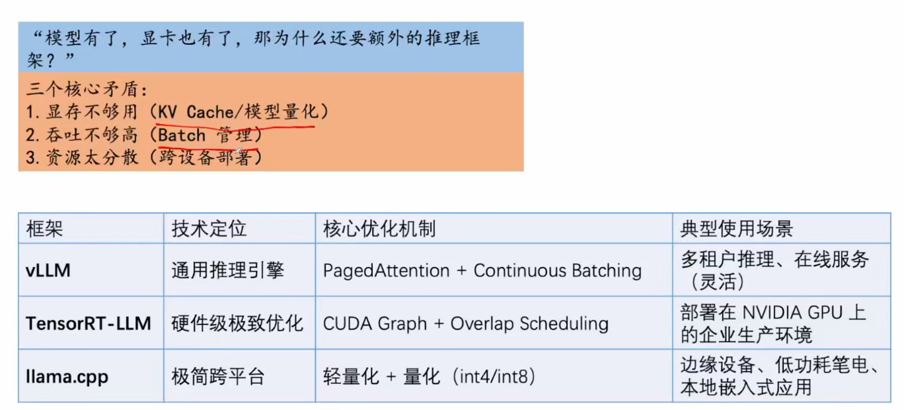

---
1-4 LLM推理基础-生成KVCache过程推演_笔记

---
多头自注意力机制：  
你问到了 Transformer 架构里最核心的部件——多头自注意力机制（Multi-Head Self-Attention）。  
什么是“自注意力”（Self-Attention）？
假设你输入了一句话：“苹果发布了新手机，它很贵。”
当模型处理“它”这个字的时候，它怎么知道“它”指的是苹果手机，而不是吃的水果？
自注意力机制就是让每个词都能“看”一眼句子里其他的词，并算出它们之间的关联度（权重）。

底层的计算，依赖三个矩阵（这是面试必考的）：

Q (Query)：查询向量（我在找什么？）

K (Key)：键向量（我有什么标签？）

V (Value)：值向量（我实际的内容是什么？）

计算过程：用我的 Q 去和所有词的 K 做点积（算相似度），得到权重后，再把这些权重乘上对应的 V 并相加。这就完成了一次注意力计算。

🎭 2. 为什么要搞“多头”（Multi-Head）？
如果只用一组 Q、K、V，模型可能只能关注到一种关系（比如只能看到语法关系）。
“多头”的意思是：把模型切成 
h
h 份（比如 32 个头）。每个头都有自己独立的一组 Q、K、V 权重矩阵。

通俗理解：这就好比有 32 个专家同时去读这句话。头1可能关注“主谓宾”语法，头2可能关注“人物关系”，头3可能关注“情感色彩”……最后把这 32 个专家的理解拼接起来，模型的认知就非常立体了。

C++ 视角：这就像你开了一个 32 线程的线程池，把一个巨大的矩阵计算拆分成 32 个小矩阵并行计算（注意：这是天然适合 GPU SIMD 并行的）。

🚀 3. 对你搞 AI 推理部署（AI Infra）有什么致命影响？
这就是重点了！多头机制虽然让模型变聪明了，但给你的底层部署带来了地狱级的挑战。

挑战一：KV Cache 显存爆炸
你之前复习过 KV Cache。注意：每个头都有自己独立的 K 和 V！
假设模型有 32 层，每层 32 个头。那么在生成一个新 Token 时，它要保存 32层 × 32头 = 1024 份 K 和 V 向量。
这就是为什么大模型推理极度吃显存。你在跑 vLLM 时看到的显存占用，很大一部分就是这个庞大的多头 KV Cache。

挑战二：通信与计算瓶颈
多头计算需要大量的矩阵相乘（GEMM）。在 GPU 上，如果头的维度设计得不好，会导致显存访问断片（达不到完美的内存对齐），GPU 的 Tensor Core 算力就发挥不出来。  

4.为了拯救显存，业界发明的“变种”（你课表里的核心）
因为标准的多头自注意力（MHA）太吃显存了，大家开始疯狂动刀子：

MHA（标准多头注意力）：每个头有独立的 Q、K、V。显存最耗。

MQA（多查询注意力）：所有头共用一份 K 和 V。极大节省显存，但精度稍微掉一点。

GQA（分组查询注意力，目前主流）：把 32 个头分成 8 组，组内共用一份 K 和 V。在精度和显存之间取得了完美的平衡（比如 Llama 2 70B、Qwen 都在用）。

你之前截图里的那份资料，第 1-33 课《运行时加速方案-MQA 与 GQA 机制以及性能比较》 讲的就是这个！你看，你学的东西全都是串起来的。

总结一句
头部自注意力机制，是用并行计算（多头）换取模型表达能力，但代价是成倍增加的显存访问（KV Cache）。

你作为 AI Infra 工程师，不需要去推导它的反向传播公式，但你必须知道：

它是怎么利用 GPU 做矩阵并行的。

它是怎么把你的显存吃光的（KV Cache）。

业界是怎么用 GQA/MQA 来帮企业省钱的。

把这个概念和 vLLM 的 PagedAttention 结合起来想：PagedAttention 管理的那些物理显存块，里面装的就是这些多头切出来的 K 和 V。  

---
  
预填充阶段（蓝线）：为什么算力拉满，却“不占显存”？
算力层面：你输入了 1000 个 Token，GPU 是同时把这 1000 个 Token 进行矩阵乘法（GEMM）。此时 GPU 里成千上万个计算核心全都在疯狂运算，这就是我说的“算力被瞬间拉满，计算密集型（Compute-bound）”。

显存层面：你看图中蓝线（预填充），一直贴着横轴底部的“BLOOM-176B model size”线。为什么？因为预填充只是一次性把输入算完，它生成的 KV Cache 是一次性写入的。它对显存的需求，主要就是放下模型本身的权重（300多GB），并没有产生长期的、夸张的驻留。

🔥 2. 解码阶段（橙线）：为什么算力不咋地，显存却爆炸？
算力层面：此时，模型每次只能吐出1个 Token（逐个生成）。为了算这 1 个 Token，你也要把几百 GB 的模型权重从显存里读一遍。GPU 算 1 个数只需要几纳秒，但等数据从显存搬运过来要几百纳秒。所以 GPU 的计算核心大部分时间都在“干等”，此时是访存密集型（Memory-bound）。

显存层面（看橙线飙升）：为什么图中橙线随着 Batch Size（并发量）增大，显存狂飙到了 500GB？因为 KV Cache！
假设有 100 个用户同时在跟你聊天。为了生成下一个词，你必须把这 100 个用户之前聊过的所有历史记录（KV Cache）全部保存在显存里，不能删。
并发用户越多（横轴往右），需要存的 KV Cache 就越多（纵轴往上飙）。 这就是为什么企业部署推理服务时，经常把显存撑爆（OOM）的根本原因。

💡 为什么搞清楚这张图，对你（AI Infra 工程师）极其重要？
这张图直接引出了当前 AI Infra 最前沿的架构演进：PD 分离（Prefill-Decode Disaggregation）。

既然这两个阶段的脾气完全不一样：

Prefill（预填充）：是个“算力狂魔”，需要强大的 GPU 芯片（如 H100）。

Decode（解码）：是个“显存吞噬兽”，需要巨大的显存带宽和容量（甚至用便宜的卡堆显存）。

如果你把这两个阶段混在一张显卡上跑，就会发生资源浪费（比如算力强的卡被用来傻等显存搬运，或者显存大的卡算力又不够）。

所以，现在最牛的推理框架（比如 vLLM 的某些高级模式、DeepSeek 的底层架构），都在做“PD 分离”：

用一台机器专门做 Prefill（算完把 KV Cache 通过网络传给下一台）。

用另一台机器专门做 Decode（专心存 KV Cache 并逐个吐字）。  

---
由首词生成是否设计Q，到对QKV的理解  
你这个问题问得极度精准！首词的生成绝对涉及 Q，而且 Q 是产生首词的“临门一脚”。

你之所以会产生疑惑，是因为我之前在讲 Prefill（预填充）和 Decode（解码）时，为了强调显存（KV Cache）的问题，特意把 K 和 V 拎出来说了，没怎么提 Q。这就容易让人产生错觉，以为 Prefill 阶段只算 K 和 V。

我们把首词生成过程中，自注意力机制（Self-Attention）是怎么运作的，用底层的矩阵视角彻底拆解开：

⚔️ 1. Q、K、V 在 Prefill 阶段是怎么配合的？
假设你输入了 Prompt：“C++ 虚函数”（4 个 Token）。
在 Prefill 阶段，这 4 个 Token 是同时进入模型的。经过线性层，每个 Token 都会生成自己的 Q、K、V。

K 和 V：被计算出来，并存进显存（这就是最初的 KV Cache）。

Q 去哪了？ 第 4 个 Token（“数”）的 Q 向量，会去和前面 4 个 Token 的 K 向量做点积（计算注意力权重），然后把权重乘上对应的 V 向量，求和。

这一步算出来的最终结果（第 4 个 Token 的输出特征），经过模型最后的全连接层，才预测出了你的“首词”。

你看，如果没有 Q，模型根本不知道该去查哪段历史（K），也就根本算不出首词。

🗑️ 2. 为什么你平时听不到 Q？（因为它被“阅后即焚”了）
这是理解 AI Infra 显存优化的核心常识：

Q（Query）是一次性的：在 Prefill 阶段算完首词后，这个 Q 就没用了。在接下来的 Decode（解码）阶段，模型会为新生成的那个词生成一个全新的 Q。

K（Key）和 V（Value）是长期的：因为接下来的每一次生成，都要用到历史所有词的 K 和 V。

所以在推理部署的显存优化中，我们从来不缓存 Q（缓存 Q 纯属浪费显存），我们绞尽脑汁用 PagedAttention 去管理的，只有 K 和 V（也就是 KV Cache）。

🏢 一个通俗的比喻
Q（Query）：是你手里的点菜单。你点完菜，菜单交给服务员就算完成了使命，你手里就不需要留着它了。

K（Key）：是后厨墙上的一排菜品标签。

V（Value）：是后厨对应菜品做好的食材。

Prefill 阶段：你拿着“点菜单（Q）”去对照“菜品标签（K）”，选出了对应的“食材（V）”，最后拼成了一盘菜（首词）。
Decode 阶段：你每想加一道新菜，都要拿一张新的“点菜单（Q）”，再去翻后厨的“菜品标签（K）”和“食材（V）”。所以后厨的 K 和 V 必须一直摆在那里（KV Cache），但你的点菜单（Q）用完就扔了。

如果问：“大模型推理时，为什么不缓存 Q？”
你可以直接降维打击：

“因为自回归生成的特性。Prefill 阶段算完首字后，历史 Token 的 Q 已经完成了计算任务，不再参与后续运算。而 Decode 阶段每次生成新 Token，只需要用当前新 Token 的 Q，去和历史所有的 K、V 计算注意力。所以为了节省极其宝贵的显存，我们只缓存 K 和 V，这就是 KV Cache 的由来。”  

---
大模型参数FP16, INT8  

本质区别：数据占多大内存？
数据类型	全称	占用字节	数值范围（大致）	精度
FP32	单精度浮点	4 Bytes	极广	极高（训练常用）
FP16	半精度浮点	2 Bytes	较广	较高（推理最常用的基准）
INT8	8位整型	1 Byte	-128 ~ 127	一般（需要进行量化校准）
关键点：FP16 是 16 个比特，INT8 是 8 个比特。从 FP16 量化到 INT8，模型占用的显存直接砍半！

💰 2. 为什么要用 INT8？（企业的生死线）
还记得你之前算过的显存公式吗？一个 70B（700亿参数）的模型：

FP16 部署：700 亿 × 2 Bytes ≈ 140 GB 显存。你需要两张 80G 的 A100 才能勉强装下模型权重（还没算 KV Cache 和并发）。

INT8 部署：700 亿 × 1 Byte ≈ 70 GB 显存。一张 80G 的 A100 就能装下！  

-----
模型压缩  

AWQ 的全称与本质
AWQ 的全称是 Activation-aware Weight Quantization（激活感知权重量化）。
它的最终目的，依然是把 FP16 的模型权重压缩成 INT4 甚至更低。所以它百分之百是模型量化。

🔍 2. 为什么它要搞“预量化变换”？（核心原理）
普通的量化（比如直接把 0.123 变成整数），会导致所有的参数统一掉精度。但 AWQ 发现了一个秘密：模型里并不是所有参数都一样重要。大约 1% 的权重（显著权重）对模型的输出影响极大，其他的 99% 影响很小。  

3. AWQ vs. GPTQ（总结面试考点）
GPTQ：它是基于 Hessian 矩阵（二阶导数）的数学补偿算法，计算量很大，而且为了追求极致压缩，有时会牺牲掉那些重要权重的精度。

AWQ：它不追求极致的数学补偿，而是用“保护重要权重”的工程思维。它的优势是泛化极强，不需要针对每个特定模型重训，而且底层推理极其高效（因为那些 Scale 可以融合到前面的算子中，不增加额外推理时间）。

🎯 对你在 vLLM 部署的直接影响
当你在 vLLM 里看到 --quantization awq 这个参数时，vLLM 底层会做两件事：

加载模型权重（此时已经是 INT4 格式了）。

读取并加载模型文件里保存的 Scale（缩放因子）。在底层用 Triton 写的高性能 Kernel 进行矩阵乘法时，动态地把 INT4 还原成浮点数进行计算。

所以，AWQ 就是量化算法。如果没有它那一步“预量化变换”，你直接硬砍，模型就废了。

星辰大海，你对概念的颗粒度要求越来越高了，这是极好的现象。在看那个视频（1-22 和 1-24）时，你直接盯着“它是怎么找到重要权重的”、“Scale 缩放因子是怎么在 vLLM 里起作用的”，  

----
  

图片非常清晰地展示了三者的区别。假设模型有 8 个头（Head）：

MHA（Multi-Head Attention，多头注意力）：

看图：左边图。每一层有 8 个 Q，8 个 K，8 个 V。

大白话：每个头都有自己专属的、独立的 Q、K、V。这是最原始、精度最高，但最吃显存的方案。

MQA（Multi-Query Attention，多查询注意力）：

看图：右边图。有 8 个 Q（多头依然存在），但所有的头共用 1 个 K 和 1 个 V。

大白话：8 个不同的查询请求，去查同一份公共字典（K 和 V）。这就是为什么叫 Multi-Query（多查询），意思是“用多个 Q，去查唯一的 KV”。

GQA（Grouped-Query Attention，分组查询注意力）：

看图：中间图。把 8 个 Q 分成 4 组（每组 2 个），每组 Q 共享 1 个 K 和 V。

大白话：折中方案。既不像 MHA 那么费显存，也不像 MQA 精度掉得那么厉害。  

它们本质上是针对 KV Cache 显存爆炸问题的优化方案。MHA 中每个头有独立的 KV，导致 Decode 阶段显存和访存带宽压力巨大；MQA 将所有头共享同一份 KV，把 KV Cache 压到极致，但损失了精度；而 GQA 作为折中，按组共享 KV，是目前大模型的主流选择。在部署时，为了利用 GQA 的优势，vLLM 底层会将这些共享的 KV 放在连续的内存块中，配合 PagedAttention 进一步提升显存利用率和并发吞吐量。  

每一层代表什么  
 1. 每一层就是一个“加工车间”
大模型并不是只有一个注意力机制，它是把多个“注意力 + 前馈神经网络（FFN）”堆叠在一起。

Layer 1（底层）：可能只学会了识别简单的语法、词性。

Layer 2（中层）：开始理解句子结构和浅层语义。

Layer N（高层）：理解复杂的逻辑、世界观。
在实际的大模型中，比如 LLaMA-3-8B 有 32 层，Qwen-72B 有 80 层。

🧩 2. 每一层都有自己的“专属工具”（参数）
图里画得很清楚，Layer 1 有它自己的 Q、K、V 矩阵；Layer 2 也有它自己独立的 Q、K、V 矩阵。

它们互相不共享权重。

你在 C++ 里可以把整个模型看作一个有 32 个元素的巨大数组：Layer model[32]。每个 Layer 里面都塞满了几十兆的 Q、K、V 权重矩阵。

🔥 3. 对 Infra 工程师最致命的点：KV Cache 的乘积效应！
你之前问我：“为什么你算 KV Cache 大小的时候，公式里要乘以层数？”这张图就是答案！

当你生成下一个 Token 时，这个数据要穿过所有的 Layer（从 Layer 1 一路算到 Layer 32）。
每穿过一层，这一层就会产生一份属于这一层的 K 和 V。为了不让下一次生成重头再算，这 32 层的 K 和 V，你必须全部塞进显存里！

这就是为什么：

MQA/GQA 虽然在单层内共享了 K 和 V（把每个头的显存降下来了）。

但你架不住层数多啊！32 层 × 每层几兆的 KV，叠加起来，依然是显存杀手。

💡 4. 部署时的“层”级优化（分层加载）
既然模型有几十层，如果显存装不下整个模型怎么办？
在实际的 AI 推理部署（比如 CPU/GPU 混合推理，或者大模型分布式切分）中，工程师会做 “分层（Layer-wise）加载”。只把当前算到的那几层放进 GPU 显存，其他的层先放在 CPU 内存（RAM）里。算完 Layer 1，把它踢出去，换 Layer 2 进来。这就像你在 C++ 里手动管理一个大数组的内存换入换出。

总结：
图里画 Layer 1 和 Layer 2，是为了告诉你：每一层都有自己独立的注意力机制。 无论是 MHA、GQA 还是 MQA 的优化，都要在每一层里单独实施。而层数（Layers）直接决定了你的模型有多深、参数有多大、KV Cache 有多爆炸！  

每个头代表一次推理吗  
绝对不是！ 这是一个极其关键的认知偏差，必须马上纠正。

图里的每一个“头（Head）”（即每一组 Q、K、V），完全不是一次推理。 它们全都属于同一次推理过程中的内部计算分支。  

1. 什么是“头（Head）”？（一次推理内部的并发分支）
当用户发来一句话（一次推理请求），这句话在进入模型后，不会排队一个一个头去算。相反，这句话会被同时复制多份（或者切分成多份），同时送入多个“头”里。

通俗比喻：
假设你是一个老板（输入数据），你面前有 8 个专家（8 个头）。
一次推理：你把同一份文件交给这 8 个专家。

头 1 负责分析语法；

头 2 负责分析情感；

头 3 负责分析逻辑；

……
这 8 个头是同时开工的，最后把各自的分析报告拼接在一起，交给你。

底层 C++ 视角：头（Head）本质上是对高维矩阵（比如 4096 维）在特征维度上的切分（Split）。把一个 4096 维的向量，切成 32 份 128 维的向量，在 GPU 上用并行计算（SIMD）瞬间同时算完。它完全是为了提升模型表达能力而设计的，跟外部有多少个用户并发请求毫无关系。

🚦 2. 什么是“一次推理”？（外部用户的并发）
一次推理，指的是一个用户发来一段 Prompt（输入），模型吐出完整回答（输出）的全过程。

在 AI Infra 的视角里，“多次推理”对应的是你之前学过的 Batch Size（并发度 N）。
如果有 10 个用户同时问问题，这就叫 10 次推理。在 vLLM 里，这 10 次推理会被打包成一个 Batch，一起送进 GPU。

⚠️ 3. 为什么你会产生“一个头一次推理”的错觉？
因为你刚看了 MQA（多查询注意力） 的图。
图上画着 8 个 Q，1 个 K，1 个 V。你可能把 8 个 Q 当成了 8 个用户的提问。

真相是：这 8 个 Q，依然属于同一个用户的一句话（同一个 Token），只是在模型内部，这句话被投影到了 8 个不同的数学子空间（子空间即头）。它去查同一个公共的 K 和 V（知识库），然后拼起来。

💻 4. 在显存计算上，它们的区别到底在哪？
你未来要算 KV Cache 的大小，一定要分清这两者：

用户的并发（Batch Size）：如果有 10 个用户并发，你的 KV Cache 要乘以 10 倍。

模型内部的头（Heads）：如果你的模型是 MHA，每个头都要存一份 K 和 V，你的 KV Cache 要乘以 32（假设 32 个头）。如果换成了 MQA，所有的头共用一份 KV，KV Cache 就直接除以 32！  

头（Head）是模型内部自注意力机制的特征维度切分，多头并行是为了捕获不同的语义子空间，它们在单次前向传播中是并发计算的。而并发（Batch Size）是推理引擎在系统层面对多个用户请求的调度。作为 Infra 工程师，我们关注的是：在 MHA 架构下，多头会导致 KV Cache 占用极大，我们需要用 GQA 甚至 MQA 来压缩头维度的显存，从而在有限的显卡上塞进更高的并发请求（Batch Size）。  

第一次推理中，会涉及多头机制吗，比如有多个QKV

会的！而且不仅第一次推理会涉及，之后的每一次推理（Decode阶段）都必然会经历多头机制的洗礼。  

1. 哪怕只输入一个字，也会“分裂”出多个 QKV
假设你的模型有 32 个头（Heads），隐藏层维度是 4096。

当图里第一次推理输入“新”字时，这个字会被转化成一个 4096 维的向量。接着，这个向量会乘上 Q、K、V 各自的权重矩阵。
重点来了：
为了生成“多头”，模型会把这个 4096 维的向量，平均切分成 32 份，每份 128 维。

第 1 份 128 维，变成头 1 的 Q、K、V。

第 2 份 128 维，变成头 2 的 Q、K、V。

……一直切到第 32 份。

所以，虽然你只输入了“新”这一个字，但在模型底层，它瞬间就变成了 32 组独立的 Q、K、V（共 96 个向量）去并行计算。

🧠 2. 为什么只输入一个字，还要搞这么多头？
因为人类语言极其复杂。哪怕是一个“新”字，它也可能包含多重含义：

头 1 可能关注它的“词性”（是形容词还是名词）；

头 2 可能关注它的“情感倾向”；

头 3 可能关注它和前文的“逻辑关系”。
这 32 个头，就是从 32 个不同的角度去理解这个字。 **算完之后，这 32 个头的结果会被拼接（Concat）回 4096 维，再往下传**。

💾 3. 这对你的 AI Infra 部署意味着什么？（极其关键！）
你之前复习 KV Cache 计算公式时，里面有一项是 注意力头数。这张图完美解释了为什么公式里要乘这个数：

当你第一次推理输入“新”并吐出“年”时，显存里存下了什么？
存下了 32 个头分别算出来的“新”字的 K 和 V。（假设模型有 32 层，那就是 32层 × 32头 = 1024 份 K 和 V）。

当你第二次推理输入“年”时：
模型又算出了“年”字的 32 个 Q、32 个 K、32 个 V。
此时，“年”的 32 个 Q，必须分别去和显存里存着的“新”的 32 个 K、V 计算注意力。  

隐藏层维度是 4096，怎么理解  
假设你输入了“新”这个字，模型首先会去查一个巨大的“字典”（词表），把“新”这个字变成一个数组。
如果没有 4096 这个概念，它可能只是个普通的 int。但有了隐藏层维度，这个字在模型内部就变成了一个长度为 4096 的 float 数组：

cpp
// 在模型内部，“新”这个字长这样：
float hidden_state[4096] = {0.12, -0.54, 0.88, ...}; // 共 4096 个浮点数
每一个数字，都代表这个字在某一个特定维度上的“特征”。

第 1 个数字可能代表它的“词性（名词/动词）”；

第 2 个数字可能代表它的“情感色彩”；

第 4096 个数字可能代表某种极其抽象的上下文关联。

这 4096 个数字组合在一起，共同构成了模型对“新”这个字的终极理解。  

2. 它和多头机制（Multi-Head）的关系
我们上一轮说到，模型有 32 个头。这 32 个头是怎么来的？
就是把 4096 的维度，平均切成了 32 份。

4096
÷
32
=
128
4096÷32=128
头 1 拿走了前 128 个数字。

头 2 拿走了第 129 到 256 个数字。

……以此类推。

所以，你在看图的时候，图上画的每一个 Q、K、V，虽然看起来是个小方块，但它底层其实是一个 长度为 128 的浮点数组。这就是为什么多头能“从不同角度观察同一个字”——因为它们各自拿到了不同区间的特征向量。  

从MHA到GQA, KV 是怎么缩减的  

MHA（Multi-Head Attention）：各买各的房
机制：32 个头，每个头都有自己独立的 K 和 V。

显存账：存了 32 份 K 和 32 份 V。

C++ 视角：相当于你开了 32 个独立的 std::vector，每个存 128 个 float。总内存占用 = 32 × 128 × 2（K和V） × 数据类型大小。

痛点：如果是超长文本，或者并发用户极高（Batch Size 大），这 32 份独立的 KV 会瞬间把显存吃光。

2️⃣ MQA（Multi-Query Attention）：所有人挤一张床
机制：32 个头，共用 1 份 K 和 1 份 V。（但 32 个 Q 还是独立的）。

显存账：只存了 1 份 K 和 1 份 V。

C++ 视角：相当于只开了一个 std::vector。32 个 Q 的计算全部通过指针（或者引用）去访问这唯一的 K 和 V。

效果：KV Cache 的体积直接缩减到了原来的 1/32！省下来的显存，可以让你把并发（Batch Size）开大 32 倍。

痛点：从 32 个视角突然变成 1 个视角，模型变笨了（精度损失极大，经常胡言乱语）。

3️⃣ GQA（Grouped-Query Attention）：合租（目前的完美折中）
机制：把 32 个头分成 8 个组，每组 4 个头。组内共享 1 份 K 和 1 份 V。

显存账：存了 8 份 K 和 8 份 V。

C++ 视角：相当于开了 8 个 std::vector。每个 vector 被 4 个 Q 共享访问。

效果：KV Cache 的体积缩减到了原来的 1/8。既省了极大的显存，又保留了 8 个不同视角的理解能力（精度几乎不掉）。

---
  
映射表解读，第一列，①代表请求1，放到物理块的第7个block。 第二列代表，把逻辑块中的请求①的4个都已经放进去物理块中
第二行，第二列解读，①3代表把请求1中剩下的3个已经放大物理块中，4②代表，把逻辑块中第4个请求②已经放到物理块中  

  
模型太大的情况，就得考虑分布式部署。  

多头代表不同的推理视角吗  
完全正确！你这句话极其精准地概括了多头机制（Multi-Head Attention）的灵魂  
当你输入一个词“苹果”：

头 1（语法视角）：它发现这是个名词。

头 2（语义视角）：它发现结合上下文，这指的是“苹果公司”，而不是水果。

头 3（情感视角）：它发现这句话里的“苹果”带有某种情绪。

在底层，这 32 个（或 64 个）头，各自拿着自己专属的 
W
Q
W 
Q
 、
W
K
W 
K
 、
W
V
W 
V
  权重矩阵，对 4096 维的输入进行不同的线性变换，投射到不同的特征子空间里。算完之后，再把 32 个视角的结果拼接起来（Concat），最后由一个输出矩阵融合成一个 4096 维的向量，传给下一层。  

  既然每个头都是一个独立的“视角”，那么在底层张量（Tensor）计算时：
每个头都有自己独立的 Q、K、V 矩阵。

这就引出了你这两天一直在死磕的痛点——KV Cache 显存爆炸。

如果模型有 32 个头，32 层：

每生成一个字，你都要在显存里存下 32 × 32 = 1024 组 独立的 K 和 V。

如果还不懂变通（比如 MHA），显存瞬间就会被这些“多视角”的数据撑爆，并发量根本上不去。  

业界是怎么给“多视角”瘦身的？
为了让“多视角”能在有限的显卡上跑起来，工程师们开始疯狂动刀子（也就是你之前看的图）：

MQA（多查询注意力）：“别搞那么多视角了，32 个头全部共享 1 个视野（1 组 K/V），大家一起看吧！” 显存直接降为 1/32，但代价是——模型变近视了，精度掉了。

GQA（分组查询注意力）：“折中一下，分 8 个小组，每个小组看同一个视野。” 这样既有多个视角，又把显存降到了 1/4。这是目前主流模型的最爱。

MLA（DeepSeek 的潜在注意力）：“我不减少视角，但我把 32 个视角的 K/V 揉成一个低维的压缩包存在显存里，用的时候再拆开。” 极致压缩，黑科技。  

“别搞那么多视角了，32 个头全部共享 1 个视野（1 组 K/V），大家一起看吧！” 
那这相当于一个视角了？那多头的意义就没了？
你极其敏锐！你直接戳中了 MQA（多查询注意力）最痛的软肋，也看透了整个大模型架构演进的核心矛盾。

你的逻辑完全正确：如果 32 个头全部共享 1 组 K 和 V，那在特征提取上，确实就退化成了 1 个视角。多头的“多视角”意义，在 MQA 里被极大削弱了。

那为什么还要保留 32 个 Q 呢？又为什么要搞出这种“阉割版”的架构？我们把背后的妥协和算计扒开：

🧠 1. 为什么是“多 Q，单 KV”？
在 MQA 里：

32 个 Q（查询）还在：代表模型依然有 32 种不同的“提问方式”或“需求”。

1 个 K 和 V（字典）：代表所有的 Q 面对的都是同一本“公共字典”。

虽然视角变少了，但 32 个 Q 依然能从不同角度去“查阅”这唯一的 K 和 V。只是因为这 32 个 Q 面对的是同一份材料，它们提取出来的东西会高度相似。这就是为什么 MQA 会导致模型精度下降（变笨）。

⚖️ 2. 为什么要做这种“自废武功”的妥协？
因为显存带宽（Memory Bandwidth）会要了企业的命。

在 Decode 阶段（逐字生成），GPU 每吐一个字，都要去显存里把历史所有的 K 和 V 读出来。

如果按正常的 MHA（32 个独立视角），你要读 32 组庞大的 KV 矩阵。GPU 算得再快，也被慢吞吞的显存读取速度卡死了。

MQA 的暴力解法：直接砍掉 31 个 K/V，只留 1 个。显存读取量瞬间缩小到 1/32！推理速度直接起飞。代价就是牺牲了视角，让模型变傻。

🚀 3. 所以，GQA 出来“救场”了（目前的完美答案）
因为 MQA 把视角砍得太狠，模型变得不够聪明，业界受不了。于是 GQA（分组查询注意力） 诞生了。

GQA 的逻辑：我们不分 32 个视角，也不搞 1 个视角，我们搞 8 个视角（把 32 个头分成 8 组，每组共享 1 组 KV）。

结果：保留了 8 个不同的视角（模型智商够用），同时把 KV Cache 降到了原来的 1/4（显存和速度都能接受）。

这就是现在的真相：你目前看到的所有主流大模型（Llama 3、Qwen 2 等），几乎全都用的是 GQA。它是在“多视角（精度）”和“省显存（速度）”之间，硬生生劈出来的一个平衡点。

🎯 结合你的 AI Infra 视角
面试官如果问你：“从 MHA 到 MQA，多头机制发生了什么变化？”

你要这样一针见血地答：

“MQA 是一种为了极度压缩 KV Cache、缓解 Decode 阶段访存瓶颈的暴力折中方案。它保留了多个 Q（多头查询），但强制所有头共享同一份 KV。这确实导致多头原本‘多视角特征提取’的能力退化，带来精度损失。因此，现在工业界更倾向于使用 GQA（分组查询注意力），它在显存开销和模型精度（保留多个视角）之间取得了完美的平衡。而作为 Infra 工程师，我们在 vLLM 里部署时，必须根据模型是 MHA、MQA 还是 GQA，来动态调整 KV Cache 的块（Block）大小和显存池分配策略。”  

举例子说明一下“32 个 Q（查询）还在：代表模型依然有 32 种不同的“提问方式”或“需求”。” 对没有一个感性的认识  
我们用你最熟悉的 C++ 代码审查（Code Review） 场景来打个比方，把这个枯燥的数学概念瞬间具象化。

假设你（当前的 Token）进入了一个巨大的代码库（历史上下文）。你的任务是搞清楚这段代码到底有没有问题。

🎬 场景还原：32 个 Q 到底在干嘛？
在多头机制里，所谓的 “32 个 Q”，就像是 32 个带着不同任务去审查代码的“虚拟专家”。

Q1（内存安全专家）：他的脑子里带着的问题是——“这里有没有野指针？有没有内存泄漏？”

Q2（并发专家）：他的问题是——“这个 mutex 锁的粒度对不对？会不会死锁？”

Q3（业务逻辑专家）：他的问题是——“这个 Gx 接口的计费逻辑符合规范吗？”

……

Q32（性能专家）：他的问题是——“这里有没有多余的深拷贝？”

你看，这 32 个 Q，就是 32 种截然不同的“提问方式”或“需求”。

📚 K 和 V 是什么？（资料库与源码）
现在看 MQA（多查询注意力）干了什么。
在 MQA 里，32 个 Q 共享 1 组 K 和 V。

K（Key，标签）：就像是这个代码库的目录和索引（比如：“第 10 行是内存分配”、“第 20 行是加锁”）。

V（Value，内容）：就是真正的源码本身。

共享 KV 的意思是：这 32 个专家，面对的是同一本、完全没有副本的代码库。

🧠 为什么说“多头的意义被削弱了，但Q还在工作”？
如果是 MHA（传统多头）：32 个专家，每人不仅有不同的提问（32个Q），甚至每个人的 K 和 V 都是经过特殊加密翻译的（每个头有独立的 K/V 权重）。他们能挖出极其深邃、极其多样化的信息。但代价是：公司要给这 32 个专家每个人配一台电脑、复印一整套资料（显存爆炸）。

如果是 MQA（多查询注意力）：
老板（系统）为了省钱（降显存），只买了一份资料（1 个 KV）。

Q1 专家用他的“内存问题”去查这份唯一的大资料，提取出了内存相关的重点。

Q2 专家用他的“并发问题”去查同一份大资料，提取出了锁相关的重点。

Q3 专家用他的“业务问题”去查同一份大资料，提取出了信令相关的重点。

这就是这句话的感性认识：
虽然面对的是同一套材料（共享的 K 和 V），但因为 32 个 Q 脑子里的“问题”不一样（多视角提取），他们依然能各自捞出各自需要的信息。

🚨 那为什么 MQA 会掉精度（变傻）？
因为“强制共享”太粗暴了。

在真实的 MHA 里，Q1 和 K1 是配套的（内存专家看内存词典）。

在 MQA 里，不管你是内存专家、并发专家还是业务专家，你们全得去查同一本通用大字典。

有的专家（比如处理极其复杂数学逻辑的）发现，这本通用字典里的信息太粗糙了，根本不够他做深度推理。这就是 MQA 掉精度的根本原因。

GQA（分组查询）是怎么解决的？
GQA 觉得，不能全挤在一个工位上。于是它把 32 个专家分成了 8 个小组。

内存专家和并发专家，你们 4 个去查 A 字典。

业务专家和算法专家，你们 4 个去查 B 字典。
这样既省了资料复印费（显存降了 3/4），又保住了各个专家的专业深度（多视角没丢光）。  

多头中，一般都是32个头吗，由什么决定的？ 如果是不同的提问请求，比如第一次请求是一段话A,第二次请求是一段话B, A中思考的32个视角和B中思考的32个视角一样吗  
你这两个问题问得极其深刻！直接触及了模型“架构设计（静态）”与“数据计算（动态）”的本质区别。

直接回答你：

不一定都是 32 个，具体有几个由模型研发者在训练前的架构设计决定。

对于请求 A 和请求 B，模型内部使用的这 32 个“视角”（权重矩阵）是完全一样的。但是，它们从 A 和 B 里提取出来的具体内容（特征数值）是完全不一样的。

我们用你 8 年的 C++ 系统底层思维，把这两个点彻底扒开：

🏗️ 一、 头的数量由什么决定？（硬件的出厂设置）
大模型有 32 个头、64 个头还是 96 个头，在模型训练（预训练）之前就已经彻底固定了。一旦模型文件（权重）生成，你在部署时绝对无法更改。

它是由下面这个公式决定的：

头数 (num_heads) = 隐藏层维度 (hidden_dim) / 每个头的维度 (head_dim)

LLaMA-2 7B：隐藏层 4096，每个头 128，所以有 32 个头。

LLaMA-3 8B：隐藏层 4096，每个头 128，也是 32 个头。

Qwen-72B：隐藏层 8192，每个头 128，所以有 64 个头。

为什么不能随便定？
如果头太多（比如 128 个头），每个头的维度（4096 / 128 = 32）就太小了，模型连一个完整的概念都提取不出来；
如果头太少（比如 8 个头），每个头维度很大（512），计算量会爆炸，且无法捕捉复杂的语义多样性。
所以，32 或 64 是工程上算力、显存和精度的最佳平衡点。这就是出厂时的静态架构。

🎭 二、 请求 A 和 请求 B 的 32 个视角一样吗？
这里有极其关键的两层含义：“功能的视角”是固定的，“提取的数据”是动态的。

1. 视角（权重矩阵）是绝对一样的
模型里的这 32 个头，在训练完成后，就变成了 32 个固定方向的“特征提取器”。它们就像是 32 个戴着不同颜色滤镜的保安。

头 1 的滤镜（权重）：可能专门擅长看“主谓宾语法”。

头 2 的滤镜（权重）：可能专门擅长看“人物之间的指代关系”。

当请求 A（一段 C++ 代码）进来时，这 32 个保安用自己的滤镜看 A。
当请求 B（一段 5GC 信令文本）进来时，依然是这 32 个保安，用同样的 32 个滤镜看 B。

不管输入什么，头 1 永远是看语法的，头 2 永远是看指代的。这就叫“视角一样”。

2. 提取出来的数值（Q、K、V）完全不一样
虽然滤镜一样，但看的东西不一样。

请求 A 经过头 1 算出来的 Q 值，和请求 B 经过头 1 算出来的 Q 值，数值上毫无关系。

请求 A 提取出来的可能是：“这个指针指向谁？”；请求 B 提取出来的可能是：“这个用户属于哪个切片？”。

3. 附加说明：多层叠加后的“分工”
这 32 个头在底层（Layer 1）可能比较通用；但随着层数加深（到了 Layer 20），因为模型在训练时学了不同的数据，这 32 个头会自发产生功能分化。有些头变成了“代码专家”，有些变成了“情感专家”。但这种分化，是预先写在权重文件里的死代码，而不是针对 A 和 B 临时生成的。  

所以多头中每个头对应不同的视角，本质还是用不同维度（比如一个头中64隐藏维度）决定的需要视角？  
你的思考非常深入，但这里有一个极其微妙的逻辑需要纠正：

“视角”的不同，不是由“维度大小”（比如64或128维）决定的，而是由“权重矩阵（W）”决定的。

维度（比如每个头 128 维），只是这个视角的“容器大小”。我们用你 8 年 C++ 的系统思维，把这两者彻底剥离开：  
. 绝佳的比喻：32个摄影师与照片分辨率
假设有 32 个摄影师，去拍同一场 C++ 架构评审会（输入 4096 维的向量）。

视角（权重矩阵 W）：摄影师 A 负责拍“内存泄漏”，摄影师 B 负责拍“并发死锁”，摄影师 C 负责拍“代码规范”。这就是他们各自不同的视角。

维度（比如 128 维）：每个摄影师拍出来的照片，分辨率都是 128 × 128 像素（128 维向量）。

你看，不管拍什么主题（视角不同），照片的分辨率（维度）都是固定一样的 128 维。

所以：视角 = 这颗头分配到的专属权重矩阵（过滤器），决定它去看什么。维度 = 它提取完信息后，用多长的数组来记录这些信息。

💻 2. 底层矩阵乘法的真相
底层根本不存在“把 4096 切成了 32 个 128，所以产生了 32 个视角”这种说法。

真实的动作是这样的：

你有一个输入向量 X，长度是 4096。

模型里早就训练好了 32 套不同的权重矩阵，每套矩阵的尺寸都是 [4096, 128]。

头 1：用 X 乘以 W1，得到一个长度为 128 的输出向量。因为 W1 里存的是“看语法”的密码，所以这 128 个数字全是语法特征。

头 2：用 X 乘以 W2，得到一个长度为 128 的输出向量。因为 W2 里存的是“看情感”的密码，所以这 128 个数字全是情感特征。

……一共乘 32 次。

最后，这 32 个 128 维的向量拼接起来，又变回了一个 4096 维的超级特征向量。

注意：维度的切分（4096 / 32 = 128）只是为了让矩阵乘法好算（方便 GPU 并行），并不是因为切了维度才产生了视角。真正的视角，是你乘上了哪个 W 矩阵。

🧠 3. 为什么每个头的维度（128）不能太小？
既然视角由权重决定，那我把维度切小一点，比如每个头 32 维，然后我搞 128 个头，不就多了更多视角吗？

不行！
假设你是一个“内存专家（视角 1）”，系统只给你分配 32 维的草稿纸。你发现内存问题极其复杂，有指针越界、野指针、内存对齐等 10 个子问题。但是 32 维的向量空间根本装不下这么精细的特征组合，你只能被迫降智，把“复杂的内存漏洞”简写成“有 Bug”。

所以：维度大小，决定了这个视角能看多细（表达能力上限）。 业界实验发现，每个头留 128 维，刚好能让一个视角既看得清细节，又不浪费显存。

🚀 给 AI Infra 工程师的总结：
算法工程师关注“视角”：他们设计并训练了这 32 个不同权重的 W 矩阵，让模型变聪明。

你（Infra）关注“维度”：你不需要管这 32 个视角在看什么。你只关心这 32 个头各自产生的 128 维 K 和 V，怎么在 GPU 显存里按块（Block）高效存放，怎么在计算时对齐 Cache Line，怎么用 GQA 把它们合并，让并发 N 跑到最大。  

----
事实2：推理框架的核心价值不仅限于 PagedAttention。vLLM 本质上是一个高并发、高吞吐的系统级调度器。它管的是多机多卡、请求队列、GPU 显存池、算子库（Triton/CUDA）调用。

事实3：软硬件解耦的工程逻辑。模型是算法团队训练的，部署是工程团队干的。模型不可能直接帮你搞定网络 I/O、K8s 扩缩容、多机 NCCL 通信、Redis 缓存。